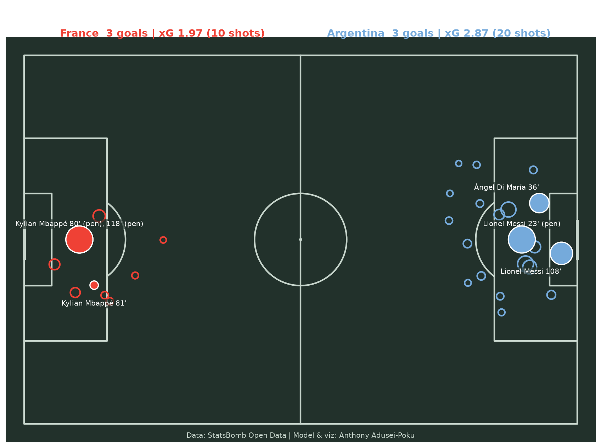
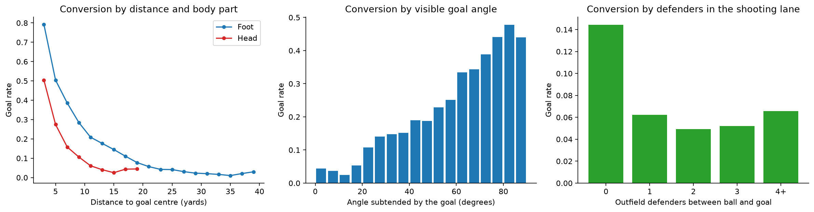
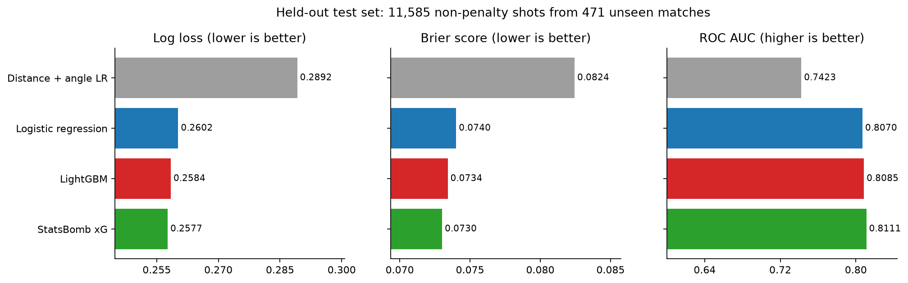
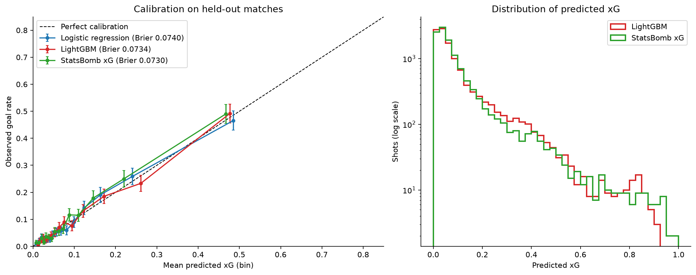
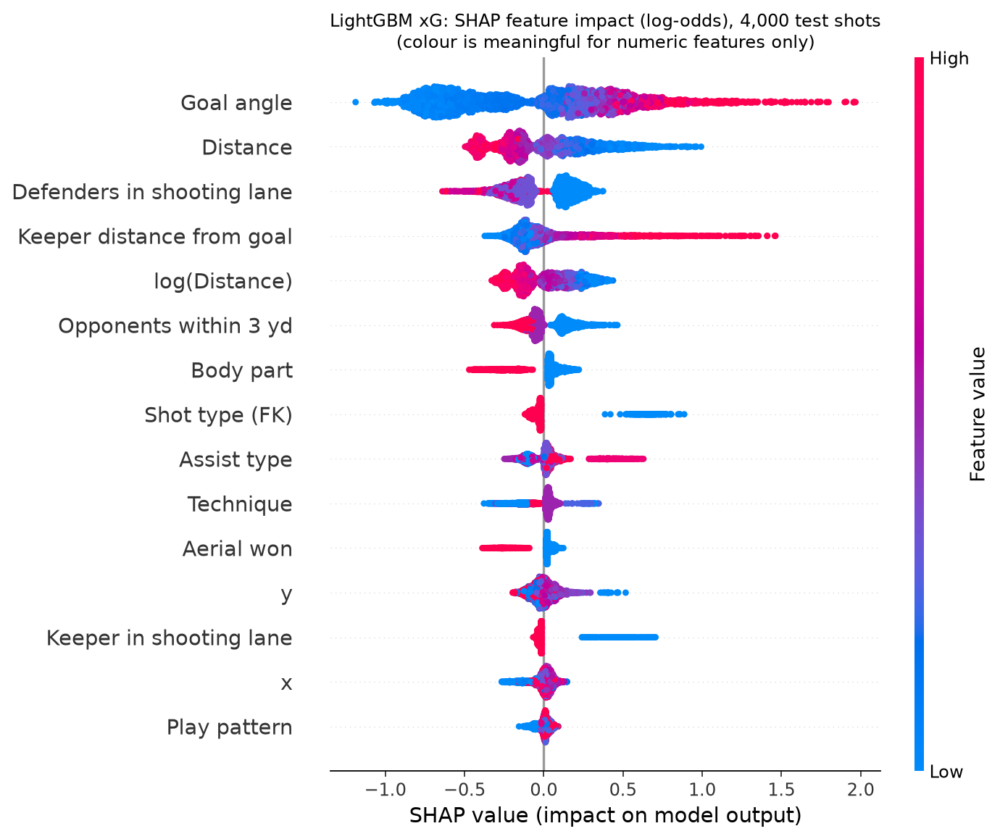
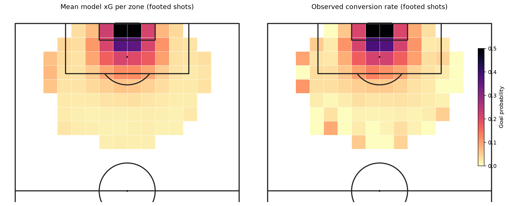
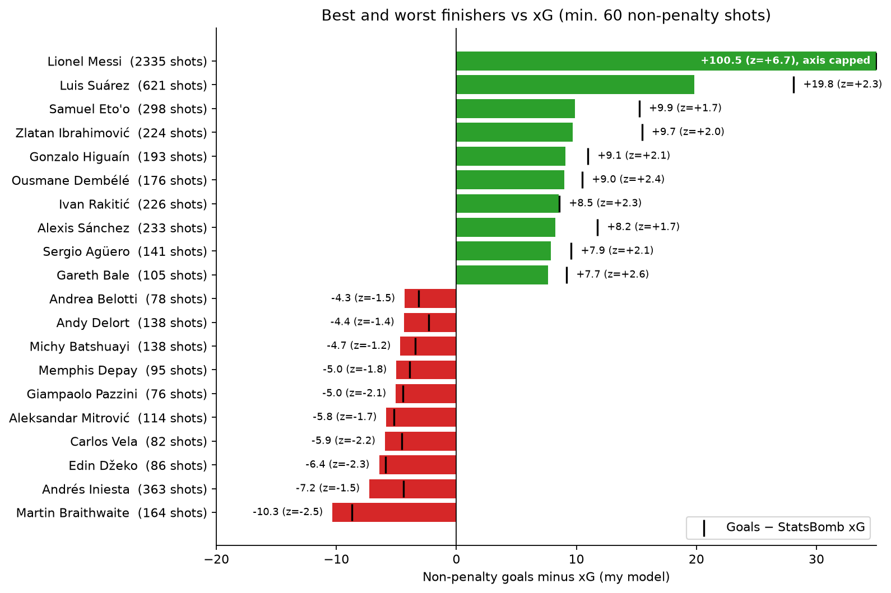
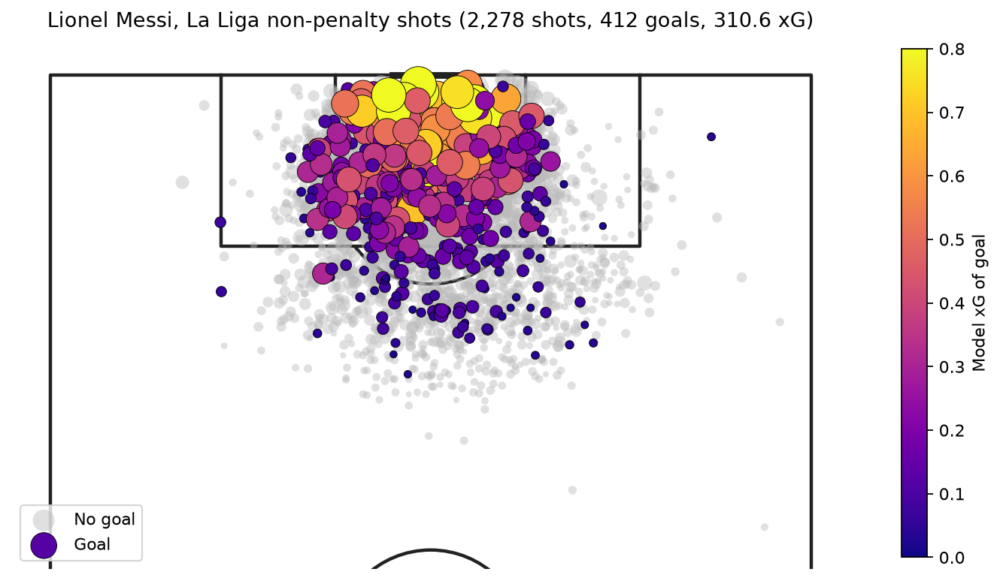

# Expected Goals (xG) Model from StatsBomb Open Data

**Predicting the probability that a shot becomes a goal, benchmarked against StatsBomb's professional xG model.**

*Anthony Adusei-Poku · MSc Data Science, University of East London (2025)*

   

<p align="center"></p>

## TL;DR

* Built a shot-level dataset of **58,576 men's shots from 2,351 matches** (57,664 non-penalty shots modelled) across 27 competition-seasons.
* Engineered geometry, technique, assist-type and **freeze-frame defensive-context** features (defenders in the shooting lane, goalkeeper position).
* On **11,585 shots from 471 matches the models never saw**, my LightGBM model scored **log loss 0.2584, Brier 0.0734 and ROC AUC 0.809**, compared with **0.2577 / 0.0730 / 0.811 for StatsBomb's own xG**. The log-loss gap (+0.0008, 95% CI −0.0019 to +0.0034) is not statistically significant.
* My model is **better calibrated in aggregate** on this data: 1,157 xG for 1,159 actual goals on the test set, compared with 1,084 from StatsBomb xG.
* Used out-of-sample xG to rank finishers. Lionel Messi scored **+100.5 non-penalty goals above expectation on 2,335 shots (z = +6.7)**, far beyond what luck would explain.

## 1. Problem

Not all shots are equal: a tap-in from six yards and a 30-yard speculative effort both count as "one shot".
**Expected goals (xG)** assigns each shot the probability that an average player scores it, given the
situation. Summed over a match or a season, xG measures chance quality far more reliably than goals, so clubs use it
for recruitment, performance analysis and opposition scouting, and media and betting firms use it too.

The goal of this project was to build an xG model from scratch on public data, evaluate it rigorously, and
check how close it gets to an industry model.

## 2. Data

[StatsBomb Open Data](https://github.com/statsbomb/open-data): event data with a freeze frame (the
positions of all visible players) at the moment of every shot.

| Competitions | Matches | Shots |
|---|---:|---:|
| Premier League, La Liga, Serie A, Ligue 1 2015/16 (full seasons) + Bundesliga 2015/16 (partial) | 1,551 | 38,728 |
| FIFA World Cup 2018 and 2022, UEFA Euro 2020 and 2024, Copa América 2024, AFCON 2023 | 314 | 7,863 |
| La Liga 2004/05 to 2020/21 excluding 2015/16 (StatsBomb's Messi/Barcelona collection) | 486 | 11,985 |
| **Total** | **2,351** | **58,576** |

**Penalties** (671 in-game, 76.0% scored; 241 shoot-out kicks, 68.5% scored) are excluded from training and valued
at the in-game conversion rate. Penalties are a fixed situation and would distort what the model learns about shot quality.

> Data © StatsBomb, used under the [StatsBomb Open Data licence](https://github.com/statsbomb/open-data/blob/master/LICENSE.pdf).
> Raw data is not included in this repository. `src/download_data.py` recreates it.

## 3. Method

### Features
| Group | Features |
|---|---|
| Geometry | distance to goal centre, angle subtended by the posts, x/y location |
| Technique | body part, technique (volley, half-volley, lob, overhead, ...), first-time, one-on-one, open goal, follows dribble, aerial won |
| Situation | open play vs direct free kick, play pattern (counter, corner, throw-in, ...), under pressure |
| Assist | key-pass type: through ball, cross, cut-back, high pass, set-piece delivery, ground pass, unassisted |
| Freeze frame | outfield opponents inside the ball-to-posts triangle, opponents within 3 yards, goalkeeper distance from goal, keeper in the shooting lane |

<p align="center"></p>

### Models and validation
* **Distance + angle logistic regression**: the textbook two-feature baseline.
* **Full logistic regression**: all features (standardised and one-hot encoded), interpretable odds ratios.
* **LightGBM** gradient boosting, with early stopping on a separate set of validation matches.
* **Split by match** (`GroupShuffleSplit`, 80/20), so shots from the same game never appear in both train and test.
* 95% confidence intervals from a **1,000-sample bootstrap over test matches**, plus a paired bootstrap for model differences.
* A **stricter generalisation test**: train on club football only, test on the six international tournaments.
* **Out-of-fold xG** (5-fold `GroupKFold` by match) for every shot, used for all player analysis, so no player is scored by a model that saw his shots.

## 4. Results

### Held-out test set (11,585 non-penalty shots, 471 unseen matches)

| Model | Log loss ↓ | Brier ↓ | ROC AUC ↑ | Total xG (actual goals: 1,159) |
|---|---:|---:|---:|---:|
| Distance + angle LR | 0.2892 | 0.0824 | 0.742 | 1,167.5 |
| Logistic regression (all features) | 0.2602 | 0.0740 | 0.807 | 1,164.6 |
| **LightGBM (all features)** | **0.2584** | **0.0734** | **0.809** | **1,157.2** |
| *StatsBomb xG (benchmark)* | *0.2577* | *0.0730* | *0.811* | *1,083.7* |

95% bootstrap CI for LightGBM log loss: [0.2467, 0.2699]; StatsBomb: [0.2452, 0.2693].

* The added features reduce log loss by **10%** compared with distance and angle alone (0.2892 → 0.2602; paired 95% CI for the difference −0.0335 to −0.0245).
* LightGBM improves slightly on the full logistic regression (−0.0018 log loss, 95% CI −0.0039 to +0.0003).
* **LightGBM is statistically indistinguishable from StatsBomb's xG** on log loss (+0.0008, 95% CI −0.0019 to +0.0034). StatsBomb remains marginally ahead on AUC (0.811 vs 0.809).
* Shot by shot, my xG correlates with StatsBomb's at **r = 0.923**.

<p align="center"></p>

### Calibration
Both my models track the diagonal closely. Across the test set StatsBomb xG predicts 6.5% fewer goals than
were scored (1,084 vs 1,159), whereas LightGBM is within 0.2% (1,157). Across all 57,664 non-penalty shots
(out-of-fold), my model gives 5,819 xG for 5,831 goals; StatsBomb gives 5,455.

<p align="center"></p>

### Generalisation: club → international
Trained on 50,155 club shots and tested on 7,509 shots from 314 international-tournament matches:

| Model | Log loss | Brier | ROC AUC |
|---|---:|---:|---:|
| Logistic regression | 0.2475 | 0.0689 | 0.794 |
| LightGBM | 0.2462 | 0.0686 | 0.793 |
| StatsBomb xG | 0.2442 | 0.0677 | 0.796 |

### What drives xG?
By mean |SHAP|, the most influential features are **goal angle (0.47)**, **distance (0.24)**, **defenders in the
shooting lane (0.18)** and **goalkeeper distance from goal (0.16)**. In the logistic regression, holding
everything else equal, a header has **0.44×** the odds of scoring of a footed shot, and a shot from a through ball has
**1.64×** the odds of one from a ground/low pass (a cross: 0.81×).

<p align="center"></p>

<p align="center"></p>

## 5. Football insight: who beats their xG?

Non-penalty goals minus out-of-sample xG, for players with at least 60 non-penalty shots (183 players). The
z-score, (G − xG) / √Σ xG(1 − xG), measures how many standard deviations each tally is from what an average
finisher would score on the same chances.

| Over-performers | Shots | Goals | xG | G − xG | z |
|---|---:|---:|---:|---:|---:|
| Lionel Messi | 2,335 | 417 | 316.5 | **+100.5** | +6.7 |
| Luis Suárez | 621 | 131 | 111.2 | +19.8 | +2.3 |
| Samuel Eto'o | 298 | 62 | 52.1 | +9.9 | +1.7 |
| Zlatan Ibrahimović | 224 | 44 | 34.3 | +9.7 | +2.0 |
| Gonzalo Higuaín | 193 | 35 | 25.9 | +9.1 | +2.1 |

| Under-performers | Shots | Goals | xG | G − xG | z |
|---|---:|---:|---:|---:|---:|
| Martin Braithwaite | 164 | 14 | 24.3 | **−10.3** | −2.5 |
| Andrés Iniesta | 363 | 24 | 31.3 | −7.3 | −1.5 |
| Edin Džeko | 86 | 6 | 12.4 | −6.4 | −2.3 |
| Carlos Vela | 82 | 6 | 12.0 | −6.0 | −2.2 |
| Aleksandar Mitrović | 114 | 10 | 15.8 | −5.8 | −1.7 |

With 183 players tested, |z| ≈ 2 is roughly what chance alone would produce for a handful of them. Messi's
z = +6.7 is the only result that clearly reflects skill rather than luck.

<p align="center"></p>
<p align="center"></p>

**2022 World Cup final (shot map at top):** in the 120 minutes, excluding the shoot-out, Argentina created
2.87 xG from 20 shots and France 1.97 xG from 10 shots (StatsBomb: 2.76 vs 2.27). The game finished 3-3.

## 6. Limitations
* **Sampling bias:** the La Liga collection only covers Barcelona matches, so Barcelona players dominate the
  finishing tables, and 2015/16 dominates the club data.
* Freeze frames only include players visible on the broadcast, so defenders or the goalkeeper are sometimes missing (1.4% of shots have no frame at all).
* There are no features for shot power, ball height at contact, weaker foot or the shooter's body shape. Professional models such as StatsBomb's use richer inputs and much more data.
* StatsBomb's model may have been trained on some of these matches, which could favour the benchmark.
* xG measures an *average* finisher. It does not account for the identity of the shooter or goalkeeper.

## 7. Next steps
* **Post-shot xG** using shot end location to evaluate goalkeepers.
* **Bayesian shrinkage** (beta-binomial / hierarchical model) for finishing skill, to rank finishers more fairly with small samples.
* Weaker-foot and pressure-intensity features, and using StatsBomb 360 data where available.
* Package the model as a small API or Streamlit app for match-report generation.

## 8. How to run

```bash
git clone <this-repo> && cd xg-model
python -m venv .venv && source .venv/bin/activate
pip install -r requirements.txt
python src/download_data.py          # ~1-2 minutes; downloads and extracts shots (~210 MB)
jupyter nbconvert --to notebook --execute --inplace xg_model.ipynb   # or open it in Jupyter
```

## Repository structure
```
xg-model/
├── xg_model.ipynb          # full analysis (executed, with outputs)
├── xg_model.html           # static HTML export of the notebook
├── src/
│   ├── download_data.py    # pulls StatsBomb open data, keeps shots + key passes
│   └── features.py         # feature engineering (geometry, freeze frame, assist type)
├── figures/                # all charts (PNG)
├── results/                # metrics, SHAP importance, player finishing table (CSV)
├── requirements.txt
└── cv_and_linkedin.md      # CV bullets and LinkedIn post
```

## Acknowledgements
Data provided by [StatsBomb](https://statsbomb.com/) through their free Open Data repository. Pitch plots made
with [mplsoccer](https://mplsoccer.readthedocs.io/).
